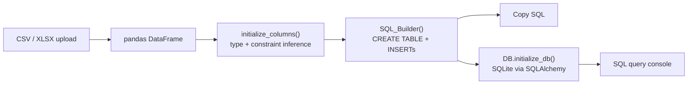

<p align="center">
  
</p>

<h1 align="center">SQLify</h1>

<p align="center">
  <b>Turn CSV and Excel files into ready-to-run SQL, then query the result right in your browser.</b>
</p>

<p align="center">
  <a href="https://csv-to-sql.streamlit.app/"></a>
  
  
  
  
</p>

---

Importing a spreadsheet into a database usually means writing a `CREATE TABLE` by hand, guessing column types, and turning every row into an `INSERT`. SQLify does that for you. Drop in one or more files, pick your database, adjust names and the primary key, and copy the generated SQL. A built-in query console loads that SQL into SQLite so you can test it before using it anywhere else.

## Features

- **Multiple files at once:** upload several `.csv` or `.xlsx` files and get one table per file.
- **Three SQL dialects:** generate SQL for **MySQL**, **PostgreSQL** or **SQLite**, with column types mapped for each.
- **Constraint detection:** a column gets `NOT NULL` when it has no missing values and `UNIQUE` when every value is distinct.
- **Primary key selector:** choose any column as the primary key. SQLify warns you if it contains `NULL`s or duplicates.
- **Editable schema:** rename the table and any column before generating. Your edits persist while you switch pages.
- **Row limit:** cap the number of `INSERT` statements (1,000 by default) for large files.
- **SQL query console:** run queries against the generated tables and see results or readable errors immediately.

## Example

Input `students.csv`:

| student_id | name  | major            | gpa |
|-----------:|-------|------------------|----:|
| 1001       | Sara  | Computer Science | 4.8 |
| 1002       | Fahad | Data Science     | 4.5 |
| 1003       | Noura | Computer Science |     |
| 1004       | Omar  | Data Science     | 4.5 |

Generated SQL (PostgreSQL, `student_id` as primary key):

```sql
CREATE TABLE students (
student_id INT PRIMARY KEY,
name VARCHAR(250) NOT NULL UNIQUE,
major VARCHAR(250) NOT NULL,
gpa REAL
);
INSERT INTO students VALUES (1001,'Sara','Computer Science',4.8);
INSERT INTO students VALUES (1002,'Fahad','Data Science',4.5);
INSERT INTO students VALUES (1003,'Noura','Computer Science',NULL);
INSERT INTO students VALUES (1004,'Omar','Data Science',4.5);
```

`gpa` has a missing value, so it isn't `NOT NULL`. `major` repeats, so it isn't `UNIQUE`.

## How it works



| pandas dtype | MySQL          | PostgreSQL     | SQLite    |
|--------------|----------------|----------------|-----------|
| `int64`      | `INT`          | `INT`          | `INTEGER` |
| `float64`    | `FLOAT`        | `REAL`         | `REAL`    |
| anything else | `VARCHAR(250)` | `VARCHAR(250)` | `TEXT`    |

## Run locally

```bash
git clone https://github.com/SultanAbdulaziz/CSV_to_DB-Project.git
cd CSV_to_DB-Project
pip install -r requirements.txt
pip install openpyxl        # needed for .xlsx uploads
streamlit run app.py
```

Then open http://localhost:8501, upload your files from the sidebar, and choose a DBMS.

## Project structure

```text
CSV_to_DB-Project/
├── app.py            # Streamlit UI: uploads, schema editing, SQL output, query console
├── src/
│   ├── pipeline.py   # Type mapping, constraint detection, CREATE TABLE / INSERT builder
│   └── DB.py         # SQLite engine, statement splitter and executor, query runner
├── SQLify_Logo.png
└── requirements.txt
```

## Roadmap

- [ ] Detect foreign keys between uploaded tables
- [ ] Map dates and booleans to native types (they currently become text)
- [ ] Escape quotes inside text values
- [ ] Run the generated SQL directly against a MySQL or PostgreSQL server

---

Built by [Sultan Aleidan](https://github.com/SultanAbdulaziz).
